> 📌 My full write-up, diagrams and screenshots for this project: https://github.com/Mamuslbebe/netflix-devsecops-pipeline
# Netflix Clone: DevSecOps CI/CD Pipeline on AWS

A full DevSecOps project. A Netflix-style React app is built, code-scanned, vulnerability-scanned, packaged, deployed to Docker and to **Amazon EKS** through **GitOps**, and then monitored, with email reports for every build.

**Tools used:** Jenkins · SonarQube · Trivy · Docker / Docker Hub · Argo CD · Amazon EKS (Auto Mode) · Helm · Prometheus · Grafana · Gmail SMTP

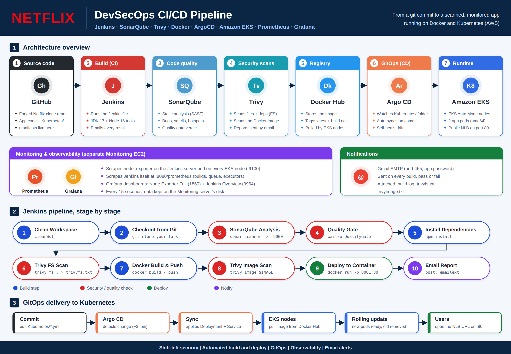

---

## Table of contents

1. [What this project does](#what-this-project-does)
2. [Architecture and network topology](#architecture-and-network-topology)
3. [Repository layout](#repository-layout)
4. [Before you start](#before-you-start)
5. [Step 1: Fork the app and get a TMDB API key](#step-1-fork-the-app-and-get-a-tmdb-api-key)
6. [Step 2: Launch the Jenkins EC2 server](#step-2-launch-the-jenkins-ec2-server)
7. [Step 3: Install Jenkins, Docker, SonarQube, Trivy](#step-3-install-jenkins-docker-sonarqube-trivy)
8. [Step 4: Configure Jenkins](#step-4-configure-jenkins)
9. [Step 5: Create and run the pipeline](#step-5-create-and-run-the-pipeline)
10. [Step 6: Monitoring server (Prometheus and Grafana)](#step-6-monitoring-server-prometheus-and-grafana)
11. [Step 7: Create the EKS cluster](#step-7-create-the-eks-cluster)
12. [Step 8: Connect kubectl to the cluster](#step-8-connect-kubectl-to-the-cluster)
13. [Step 9: Monitor the EKS nodes](#step-9-monitor-the-eks-nodes)
14. [Step 10: Install Argo CD](#step-10-install-argo-cd)
15. [Step 11: Deploy the app with GitOps](#step-11-deploy-the-app-with-gitops)
16. [Step 12: Clean up (avoid AWS charges)](#step-12-clean-up-avoid-aws-charges)
17. [Troubleshooting (real errors from this build)](#troubleshooting-real-errors-from-this-build)
18. [Screenshots](#screenshots)
19. [Credits](#credits)

---

## What this project does

| Phase | Tool | What happens |
|---|---|---|
| Source | GitHub | The app code and the Kubernetes manifests live in a fork of the original repo |
| CI | Jenkins | Every build runs the 10 stages shown above |
| Code quality (SAST) | SonarQube | Finds bugs, code smells and security hotspots; quality gate gives pass/fail |
| Vulnerability scans | Trivy | Scans the source files and dependencies, then scans the finished Docker image |
| Package | Docker, Docker Hub | Builds the image and pushes `latest` plus a build-number tag |
| Deploy (Docker) | Docker | Runs the app on the Jenkins server at port **8081** |
| Deploy (Kubernetes) | Argo CD, Amazon EKS | Argo CD watches the `Kubernetes/` folder in Git and keeps the cluster in sync |
| Monitor | Prometheus, Grafana | Server metrics, Jenkins metrics and EKS node metrics on dashboards |
| Notify | Gmail | Every build emails its status, the build log and both Trivy reports |

---

## Architecture and network topology

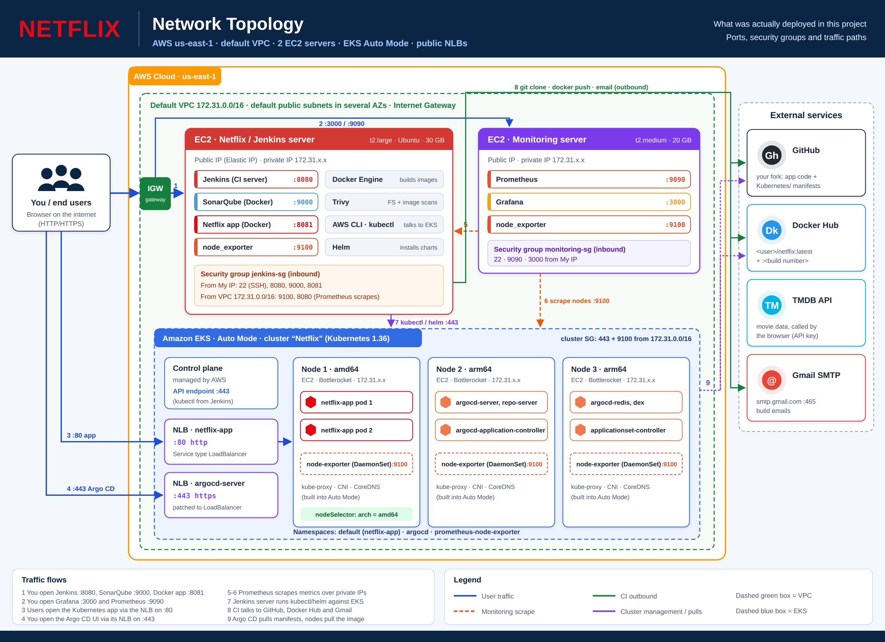

Both diagrams are also available as SVG files in [`docs/images/`](docs/images/).

**Servers and ports**

| Machine | Size | Runs | Ports |
|---|---|---|---|
| Netflix / Jenkins server (EC2) | t2.large, 30 GB | Jenkins, SonarQube (Docker), Netflix app (Docker), Trivy, node_exporter, AWS CLI, kubectl, Helm | 22, 8080, 9000, 8081, 9100 |
| Monitoring server (EC2) | t2.medium, 20 GB | Prometheus, Grafana, node_exporter | 22, 9090, 3000, 9100 |
| EKS cluster `Netflix` (Auto Mode) | nodes created automatically | Netflix pods, Argo CD, node-exporter DaemonSet | 80 (app NLB), 443 (Argo CD NLB), 9100 inside the VPC |

---

## Repository layout

```
.
├── Jenkinsfile                       # The CI pipeline
├── Kubernetes/
│   ├── deployment.yml                # 2 Netflix pods, pinned to amd64 nodes
│   └── service.yml                   # Public Network Load Balancer on port 80
├── argocd/
│   └── netflix-application.yaml      # Optional: create the Argo CD app with kubectl
├── monitoring/
│   ├── prometheus.yml                # All scrape jobs
│   ├── prometheus.service            # systemd unit
│   └── node_exporter.service         # systemd unit
├── scripts/
│   ├── 01-jenkins-server-setup.sh    # Jenkins, Docker, SonarQube, Trivy, node_exporter
│   ├── 02-monitoring-server-setup.sh # Prometheus, node_exporter, Grafana
│   ├── 03-eks-tools-setup.sh         # AWS CLI, kubectl, Helm
│   └── 99-cleanup.sh                 # Removes Kubernetes load balancers before deleting EKS
├── docs/images/                      # Flowchart and network topology (PNG + SVG)
└── screenshots/                      # Proof that each part worked
```

---

## Before you start

You need:

- An **AWS account**. Sign in as an IAM user with admin rights, not the root user.
- A **GitHub** account.
- A **Docker Hub** account.
- A **Gmail** account with 2-Step Verification turned on, so you can create an app password.
- A **TMDB** account for the movie API key.

> **Cost warning.** EC2 instances, the EKS control plane (about $0.10/hour), EKS Auto Mode nodes and load balancers all bill by the hour. Do the project in one or two sittings, and run [Step 12](#step-12-clean-up-avoid-aws-charges) when you finish.

> **Region.** Everything in this guide uses **us-east-1 (N. Virginia)**. Check the region selector at the top right of the AWS console before creating anything.

> **Secrets.** Never put passwords, tokens, API keys or AWS access keys in Git or in screenshots. This project stores them as Jenkins credentials.

---

## Step 1: Fork the app and get a TMDB API key

1. Open <https://github.com/N4si/DevSecOps-Project>.
2. Click **Fork** (top right, between Watch and Star), keep your account as the owner, and click **Create fork**. You now have `https://github.com/<your-username>/DevSecOps-Project`.
3. Get a TMDB API key: sign in at <https://www.themoviedb.org>, then open **Settings → API → Create**, and choose Developer. Copy the **API Key (v3 auth)**.

You'll edit the `Kubernetes/` folder in your fork in Step 11.

---

## Step 2: Launch the Jenkins EC2 server

1. Go to **EC2 → Launch instance**.
   - Name: `Netflix`
   - AMI: **Ubuntu Server** (latest LTS)
   - Instance type: **t2.large**. Jenkins and SonarQube together need about 8 GB of RAM.
   - Key pair: create one or pick an existing one.
   - Storage: **30 GB**. Docker images and the Trivy database fill disks quickly.
2. Under **Network settings → Edit**, create a security group named `jenkins-sg` with these inbound rules:

   | Type | Port | Source | Why |
   |---|---|---|---|
   | SSH | 22 | My IP | Log in |
   | Custom TCP | 8080 | My IP | Jenkins |
   | Custom TCP | 9000 | My IP | SonarQube |
   | Custom TCP | 8081 | My IP | Netflix app (Docker) |
   | Custom TCP | 8080 | 172.31.0.0/16 | Prometheus scrapes Jenkins |
   | Custom TCP | 9100 | 172.31.0.0/16 | Prometheus scrapes node_exporter |

3. Click **Launch instance**.
4. **Recommended:** go to **EC2 → Elastic IPs → Allocate**, then **Associate** it with the instance. Without an Elastic IP, the public IP changes every time you stop and start the instance.

> If your home internet IP changes (after a router restart, for example), the "My IP" rules stop matching and the web pages won't load. Edit the rules and pick **My IP** again.

---

## Step 3: Install Jenkins, Docker, SonarQube, Trivy

Connect to the server: select the instance, click **Connect**, and use **EC2 Instance Connect** (or SSH with your key).

**Option A: run the script (fastest).** Copy [`scripts/01-jenkins-server-setup.sh`](scripts/01-jenkins-server-setup.sh) to the server, then:

```bash
nano setup.sh          # paste the script contents, then Ctrl+O, Enter, Ctrl+X
chmod +x setup.sh
./setup.sh
```

**Option B: run each part by hand.**

```bash
# System packages and Java 21 (needed to run Jenkins)
sudo apt-get update -y
sudo apt-get install -y fontconfig openjdk-21-jre wget curl gnupg unzip git

# Jenkins LTS
sudo mkdir -p /etc/apt/keyrings
sudo wget -qO /etc/apt/keyrings/jenkins-keyring.asc https://pkg.jenkins.io/debian-stable/jenkins.io-2026.key
echo "deb [signed-by=/etc/apt/keyrings/jenkins-keyring.asc] https://pkg.jenkins.io/debian-stable binary/" | sudo tee /etc/apt/sources.list.d/jenkins.list > /dev/null
sudo apt-get update -y
sudo apt-get install -y jenkins
sudo systemctl enable --now jenkins

# Docker, and permission for the jenkins and ubuntu users to use it
sudo apt-get install -y docker.io
sudo usermod -aG docker ubuntu
sudo usermod -aG docker jenkins
sudo systemctl restart jenkins

# SonarQube in a container on port 9000
sudo docker run -d --name sonar -p 9000:9000 --restart unless-stopped sonarqube:lts-community

# Trivy
wget -qO - https://get.trivy.dev/deb/public.key | gpg --dearmor | sudo tee /usr/share/keyrings/trivy.gpg > /dev/null
echo "deb [signed-by=/usr/share/keyrings/trivy.gpg] https://get.trivy.dev/deb generic main" | sudo tee /etc/apt/sources.list.d/trivy.list > /dev/null
sudo apt-get update -y
sudo apt-get install -y trivy
```

For node_exporter, copy the node_exporter section of the script, or follow [Step 6.2](#62-node_exporter-on-both-servers).

**Check it worked:**

```bash
sudo systemctl status jenkins --no-pager     # active (running)
docker ps                                    # sonar is Up, with 0.0.0.0:9000->9000
trivy --version
sudo cat /var/lib/jenkins/secrets/initialAdminPassword
```

> If `docker ps` says *permission denied*, log out and back in so the new docker group takes effect, or use `sudo docker ps`.

---

## Step 4: Configure Jenkins

### 4.1 Unlock Jenkins

Open `http://<jenkins-public-ip>:8080`, paste the initial admin password, choose **Install suggested plugins**, and create your admin user.

### 4.2 Install plugins

Go to **Manage Jenkins → Plugins → Available plugins**, install these, then restart Jenkins:

- Eclipse Temurin installer
- SonarQube Scanner
- NodeJS
- Email Extension Template
- Prometheus metrics
- Pipeline: Stage View
- Workspace Cleanup (may already be installed)

### 4.3 Set up SonarQube

1. Open `http://<jenkins-public-ip>:9000` and log in with `admin` / `admin`. Set a new password when asked.
2. Create a token: **My Account (avatar) → Security → Generate Tokens**. Choose type *Global Analysis Token*, then copy the token.
3. Create the webhook used by the Quality Gate stage: **Administration → Configuration → Webhooks → Create**.
   - Name: `jenkins`
   - URL: `http://<jenkins-private-ip>:8080/sonarqube-webhook/` (the trailing `/` is required)

Find the private IP in the EC2 console, or by running `hostname -I` on the server.

### 4.4 Add credentials

Go to **Manage Jenkins → Credentials → System → Global credentials → Add Credentials**. The IDs must match exactly, because the Jenkinsfile refers to them by ID.

| Kind | ID | Value |
|---|---|---|
| Secret text | `sonar-token` | The SonarQube token from 4.3 |
| Username with password | `dockerhub` | Docker Hub username, and a Docker Hub **access token** (Account settings → Personal access tokens) |
| Secret text | `tmdb-api-key` | Your TMDB API key |
| Username with password | `mail` | Your Gmail address, and a Gmail **app password** (Google Account → Security → App passwords) |

### 4.5 Configure tools

Go to **Manage Jenkins → Tools**:

- **JDK installations → Add JDK.** Name `jdk17`, tick *Install automatically*, choose *Install from adoptium.net*, and pick a **jdk-17** version.
- **NodeJS installations → Add NodeJS.** Name `node16`, and pick version **16.x**.
- **SonarQube Scanner installations → Add.** Name `sonar-scanner`, tick *Install automatically*, latest version.

Click **Save**.

### 4.6 Connect Jenkins to SonarQube

Go to **Manage Jenkins → System → SonarQube servers → Add SonarQube**:

- Name: `SonarQube-Server`
- Server URL: `http://<jenkins-private-ip>:9000`
- Server authentication token: `sonar-token`

### 4.7 Configure email

Still in **Manage Jenkins → System**:

1. **Jenkins Location → System Admin e-mail address:** your Gmail address. This sets the "From" name on build emails.
2. **Extended E-mail Notification.** This is the section the pipeline uses.
   - SMTP server: `smtp.gmail.com`, SMTP port: `465`
   - Click **Advanced**: Credentials `mail`, tick **Use SSL**
   - Default Content Type: **HTML (text/html)**
3. **E-mail Notification.** This basic section is only used for testing.
   - SMTP server `smtp.gmail.com`. Under Advanced: tick *Use SMTP Authentication* and enter your Gmail address and app password, tick *Use SSL*, port `465`.
   - Tick *Test configuration by sending test e-mail*, enter your address, and click **Test configuration**.

Click **Save**.

---

## Step 5: Create and run the pipeline

1. Open [`Jenkinsfile`](Jenkinsfile) and change the three values marked `CHANGE ME`:
   - `GIT_REPO`: your fork's URL
   - `IMAGE`: `<your-dockerhub-username>/netflix`
   - `NOTIFY_EMAIL`: your email address
2. In Jenkins, click **New Item**, name it `netflix`, choose **Pipeline**, and click OK.
3. Under **Pipeline → Definition: Pipeline script**, clear the box completely (Ctrl+A, then Delete), paste the whole Jenkinsfile, and click **Save**.
   - Alternative: choose *Pipeline script from SCM* and point it at a repo that contains this Jenkinsfile.
4. Click **Build Now**.

**Check it worked:**

- All stages turn green in **Stages** (or Stage View).
- SonarQube shows a **Netflix** project with a **Passed** quality gate.
- `docker ps` on the server shows **netflix-app** with `0.0.0.0:8081->80/tcp`.
- The app opens at `http://<jenkins-public-ip>:8081`.
- An email arrives with `build.log`, `trivyfs.txt` and `trivyimage.txt` attached. Check your spam folder the first time.

**What each stage does**

| # | Stage | What it does |
|---|---|---|
| 1 | Clean Workspace | Deletes files from the previous build |
| 2 | Checkout from Git | Clones your fork |
| 3 | SonarQube Analysis | Sends the code to SonarQube for analysis |
| 4 | Quality Gate | Waits for SonarQube's pass/fail verdict through the webhook |
| 5 | Install Dependencies | `npm install` |
| 6 | Trivy FS Scan | Scans files and dependencies for known CVEs and secrets, saved to `trivyfs.txt` |
| 7 | Docker Build & Push | Builds the image with the TMDB key and pushes `latest` plus `<build number>` |
| 8 | Trivy Image Scan | Scans the finished image, including OS packages, saved to `trivyimage.txt` |
| 9 | Deploy to Container | Removes the old `netflix-app` container and starts the new one on port 8081 |
| 10 | Email (post) | Always sends the result, with the log and both reports attached |

> The Quality Gate is set to `abortPipeline: false`, so a failed gate is reported without stopping the build. Change it to `true` to block deployments of code that fails the gate.

---

## Step 6: Monitoring server (Prometheus and Grafana)

### 6.1 Launch the Monitoring EC2

Launch a second Ubuntu instance named `Monitoring`: **t2.medium**, 20 GB, in the same default VPC. Create a security group `monitoring-sg` with inbound **22, 9090, 3000** from **My IP**.

Then run [`scripts/02-monitoring-server-setup.sh`](scripts/02-monitoring-server-setup.sh) on it the same way as in Step 3. It installs Prometheus, node_exporter and Grafana as services that start automatically at boot.

> The script pins **Prometheus 3.13.1** and **node_exporter 1.12.1**. You can update `PROM_VERSION` and `NODE_EXPORTER_VERSION` at the top to the newest releases on GitHub.

### 6.2 node_exporter on both servers

The scripts install node_exporter on both servers. Check each one with:

```bash
sudo systemctl status node_exporter --no-pager
curl -s http://localhost:9100/metrics | head -3
```

### 6.3 Tell Prometheus what to scrape

On the **Monitoring** server:

```bash
sudo nano /etc/prometheus/prometheus.yml
```

Replace the contents with [`monitoring/prometheus.yml`](monitoring/prometheus.yml), and put in the Jenkins server's **private** IP. Private IPs stay the same when you stop and start instances. Leave the `eks_nodes` job until Step 9, or comment it out with `#`.

```bash
promtool check config /etc/prometheus/prometheus.yml    # must print SUCCESS
sudo systemctl restart prometheus
sudo systemctl status prometheus --no-pager
```

Open `http://<monitoring-public-ip>:9090/targets`. Every target should show **UP**.

> **YAML uses spaces, never tabs.** A tab or a wrongly indented line gives `did not find expected key` and Prometheus won't start. See [Troubleshooting](#troubleshooting-real-errors-from-this-build).

### 6.4 Grafana dashboards

1. Open `http://<monitoring-public-ip>:3000` and log in with `admin` / `admin`. Set a new password.
2. **Connections → Data sources → Add data source → Prometheus.** URL `http://localhost:9090`, then **Save & test**.
3. **Dashboards → New → Import:**
   - **1860**, Node Exporter Full (server CPU, memory and disk). Use the **Job** dropdown to switch between servers.
   - **9964**, Jenkins: Performance and Health Overview.

If panels say *No data*, set the time range to **Last 15 minutes**, wait a few minutes, and click **Refresh**.

---

## Step 7: Create the EKS cluster

This guide uses **EKS Auto Mode**. AWS creates and removes worker nodes automatically, so there are no node groups to manage.

1. **EKS → Clusters → Create cluster → Quick configuration (EKS Auto Mode).**
   - Name: `Netflix`
   - **Cluster IAM role:** click **Create new role**, accept the defaults, come back, refresh, and select it (`AmazonEKSAutoClusterRole`).
   - **Node IAM role:** click **Create new role** again (`AmazonEKSAutoNodeRole`). This must be a **separate** role from the cluster role.
   - VPC: the **default VPC**. Subnets: leave the defaults selected; you need at least two in different Availability Zones.
2. Click **Create** and wait about 10–15 minutes for the status to show **Active**.
3. **Tag the subnets for public load balancers.** In **VPC → Subnets**, for each subnet the cluster uses, go to **Tags → Manage tags** and add key `kubernetes.io/role/elb` with value `1`.
4. **Open the cluster to the VPC.** Go to **EKS → Netflix → Networking** and click the **Cluster security group**, then **Edit inbound rules** and add:

   | Type | Port | Source | Why |
   |---|---|---|---|
   | HTTPS | 443 | 172.31.0.0/16 | kubectl from the Jenkins server |
   | Custom TCP | 9100 | 172.31.0.0/16 | Prometheus scrapes the nodes |

> **Classic alternative:** older tutorials use node groups. To do it that way, pick *Custom configuration*, turn Auto Mode off, keep the VPC CNI, kube-proxy and CoreDNS add-ons, and then add a managed node group (for example 2 × t3.medium).

---

## Step 8: Connect kubectl to the cluster

Run these on the **Jenkins** server.

**1. Install the tools.** Run [`scripts/03-eks-tools-setup.sh`](scripts/03-eks-tools-setup.sh), which installs the AWS CLI v2, kubectl and Helm.

**2. Create an IAM user for the command line** (don't create access keys for the root user):

- **IAM → Users → Create user**, named `eks-admin`. Choose **Attach policies directly → AdministratorAccess** (fine for a learning project).
- Open the user, then **Security credentials → Create access key → Command Line Interface (CLI)**. Copy both keys and keep them private.

**3. Give that user access to the cluster.** Go to **EKS → Netflix → Access → IAM access entries → Create**:

- IAM principal: `arn:aws:iam::<account-id>:user/eks-admin`
- Access policy: `AmazonEKSClusterAdminPolicy`, with scope **Cluster**

**4. Connect:**

```bash
aws configure                      # access key, secret key, us-east-1, json
aws sts get-caller-identity        # should show user/eks-admin
aws eks update-kubeconfig --name Netflix --region us-east-1
kubectl get svc                    # should list the "kubernetes" service
```

---

## Step 9: Monitor the EKS nodes

Install node exporter on every node with Helm:

```bash
helm repo add prometheus-community https://prometheus-community.github.io/helm-charts
helm repo update
kubectl create namespace prometheus-node-exporter
helm install prometheus-node-exporter prometheus-community/prometheus-node-exporter \
  --namespace prometheus-node-exporter
kubectl get pods -n prometheus-node-exporter        # one Running pod per node
kubectl get nodes -o wide                           # copy the INTERNAL-IP values
```

> With Auto Mode, a node may only appear after you deploy something. If the list is empty, come back to this step after Step 10.

On the **Monitoring** server, add the node IPs to the `eks_nodes` job in `prometheus.yml`, then check and restart:

```bash
promtool check config /etc/prometheus/prometheus.yml
sudo systemctl restart prometheus
```

On the Targets page, `eks_nodes` should show every node **UP**. In Grafana's **Node Exporter Full** dashboard, set **Job** to `eks_nodes`.

> Auto Mode can replace nodes over time, and new nodes get new IPs. If a target goes DOWN, run `kubectl get nodes -o wide` again and update the IPs.

---

## Step 10: Install Argo CD

```bash
kubectl create namespace argocd
# --server-side avoids the "annotations: Too long" error on the large ApplicationSet CRD
kubectl apply -n argocd --server-side --force-conflicts \
  -f https://raw.githubusercontent.com/argoproj/argo-cd/stable/manifests/install.yaml
kubectl get pods -n argocd -w        # wait until every pod is 1/1 Running, then Ctrl+C
```

Expose the UI through a public Network Load Balancer:

```bash
kubectl annotate svc argocd-server -n argocd \
  service.beta.kubernetes.io/aws-load-balancer-scheme=internet-facing
kubectl patch svc argocd-server -n argocd \
  -p '{"spec":{"type":"LoadBalancer","loadBalancerClass":"eks.amazonaws.com/nlb"}}'
kubectl get svc argocd-server -n argocd     # wait for an EXTERNAL-IP ending in .elb.amazonaws.com
```

Get the admin password:

```bash
kubectl -n argocd get secret argocd-initial-admin-secret \
  -o jsonpath="{.data.password}" | base64 -d; echo
```

Open `https://<EXTERNAL-IP>`, using **https**. Click through the certificate warning (*Advanced → Proceed*), then log in as `admin`.

---

## Step 11: Deploy the app with GitOps

### 11.1 Edit the manifests in your fork

In your fork on GitHub, open the `Kubernetes/` folder:

1. Open `deployment.yml`, click the ✏️ pencil icon, select everything (Ctrl+A), and paste [`Kubernetes/deployment.yml`](Kubernetes/deployment.yml). Change the image to `<your-dockerhub-username>/netflix:latest`, then click **Commit changes**.
2. Do the same for `service.yml` with [`Kubernetes/service.yml`](Kubernetes/service.yml).
3. If there is a `node-service.yaml` file, delete it (⋯ → *Delete file* → commit). It expects a namespace that this setup doesn't use, so Argo CD would show *Sync failed*. Node monitoring is already handled by Helm in Step 9.

> **Why `nodeSelector: amd64`?** The image is built on an amd64 (Intel/AMD) server. EKS Auto Mode can also launch arm64 (Graviton) nodes, and an amd64 image crashes on those with `exec format error`. The selector keeps the pods on amd64 nodes.

### 11.2 Create the Argo CD app

In the Argo CD UI, click **+ NEW APP** and fill in:

| Field | Value |
|---|---|
| Application Name | `netflix` |
| Project Name | `default` (not `netflix`) |
| Sync Policy | Automatic |
| Repository URL | `https://github.com/<your-username>/DevSecOps-Project.git` |
| Revision | `main` |
| Path | `Kubernetes` |
| Cluster URL | `https://kubernetes.default.svc` |
| Namespace | `default` |

Click **CREATE**. Alternatively, edit and apply [`argocd/netflix-application.yaml`](argocd/netflix-application.yaml) with `kubectl apply -f`.

After a minute or two the card shows **Healthy** and **Synced**.

### 11.3 Open the app

```bash
kubectl get svc netflix-app       # copy the EXTERNAL-IP (.elb.amazonaws.com)
kubectl get pods -o wide          # 2 Running pods, both on the amd64 node
```

Open `http://<EXTERNAL-IP>` with plain **http**. The Netflix clone loads, now running on Kubernetes.

### 11.4 See GitOps in action

Change something in `Kubernetes/deployment.yml` in your fork (for example `replicas: 3`) and commit. Within about 3 minutes Argo CD notices the commit and updates the cluster. Watch it with `kubectl get pods -w`. Changes always go through Git, not through kubectl.

---

## Step 12: Clean up (avoid AWS charges)

Go in this order. The load balancers have to be removed **before** the cluster is deleted, or they can be left behind and keep billing.

1. On the Jenkins server, run [`scripts/99-cleanup.sh`](scripts/99-cleanup.sh). It deletes the Argo CD app, node exporter and Argo CD, and then shows any remaining load balancer services; the list should be empty.
2. **EKS → Clusters → Netflix → Delete cluster** (about 10–15 minutes).
3. **EC2 → Load Balancers:** delete any leftover `k8s-...` load balancers.
4. **EC2 → Instances:** terminate `Netflix` and `Monitoring`.
5. **EC2 → Volumes:** delete any volume showing **available**.
6. **EC2 → Elastic IPs:** release them. Unattached Elastic IPs are billed.
7. **IAM:** delete the `eks-admin` user and, optionally, the EKS roles.
8. Revoke the remaining secrets: the Gmail app password, the Docker Hub access token, and regenerate your TMDB key.
9. **Billing → Budgets:** create a *zero spend* budget so AWS emails you if anything is still running.

---

## Troubleshooting (real errors from this build)

| Symptom | Cause | Fix |
|---|---|---|
| `E212: Can't open file for writing` in vim | The file is owned by root | Open it with `sudo vim ...`, or save with `:w !sudo tee % > /dev/null` |
| Pipeline fails at Deploy with `Bind for 0.0.0.0:8081 failed: port is already allocated` | An old container (often with a random name) still holds port 8081 | `docker ps --filter publish=8081`, then `docker rm -f <name>`. The Jenkinsfile uses a fixed name, `netflix-app`, so this doesn't repeat |
| Container is running but the app won't load; the PORTS column is empty | The container was started without `-p` | `docker rm -f` it and run it again with `-p 8081:80` |
| `unexpected token: } @ line 107` | An extra `}` was left behind when pasting the script | Clear the script box fully before pasting. The file should end with `}` `}` `}` |
| Pipeline works but no email arrives | Settings were entered only in the basic *E-mail Notification* section | `emailext` uses **Extended E-mail Notification**. Use port 465, SSL, and the app password |
| Prometheus: `Start request repeated too quickly` | It failed 5 times in a row (often a YAML error), so systemd stopped retrying | Fix the YAML, then `sudo systemctl reset-failed prometheus && sudo systemctl start prometheus` |
| `yaml: line 40: did not find expected key` | Wrong indentation, or a tab, in `prometheus.yml` | Line up `- job_name` with the other jobs, using spaces. Run `promtool check config` |
| Grafana shows *No data* | Too little data yet, or the wrong Job is selected | Wait a few minutes, use *Last 15 minutes*, and check the Job dropdown and the Targets page |
| `kubectl get svc` times out at `...:443: i/o timeout` | The cluster security group blocks the Jenkins server | Add an inbound HTTPS 443 rule from `172.31.0.0/16` |
| `You must be logged in to the server (Unauthorized)` | Your IAM user has no access entry | EKS → Access → Create access entry with `AmazonEKSClusterAdminPolicy` |
| `argocd-applicationset-controller` in CrashLoopBackOff | The ApplicationSet CRD was too large for a normal apply | Re-apply with `--server-side --force-conflicts`, then `kubectl rollout restart deployment argocd-applicationset-controller -n argocd` |
| Argo CD: `app is not allowed in project "netflix"` | The Project field was set to the app name | Project must be `default` |
| Argo CD: `namespaces "prometheus-node-exporter" not found` | `node-service.yaml` is in the repo but the namespace doesn't exist | Delete `node-service.yaml` from the fork, or do Step 9 first |
| Load balancer EXTERNAL-IP stays `<pending>` | The subnets are missing the ELB tag | Add `kubernetes.io/role/elb = 1` to the cluster's subnets |
| Movies don't load, or *The media could not be loaded* | A bad TMDB key, a browser extension blocking TMDB or YouTube, or just the trailer | Test the key: `curl "https://api.themoviedb.org/3/movie/popular?api_key=<key>"`. Try an incognito window |
| Web pages stop loading after a break | Your home IP changed, so the "My IP" rules no longer match | Edit the inbound rules and pick **My IP** again |
| Pod crashes with `exec format error` | An amd64 image was scheduled on an arm64 node | Add `nodeSelector: kubernetes.io/arch: amd64` (already in `deployment.yml`) |

---

## Screenshots

| | |
|---|---|
| **Jenkins: quality gate passed**<br>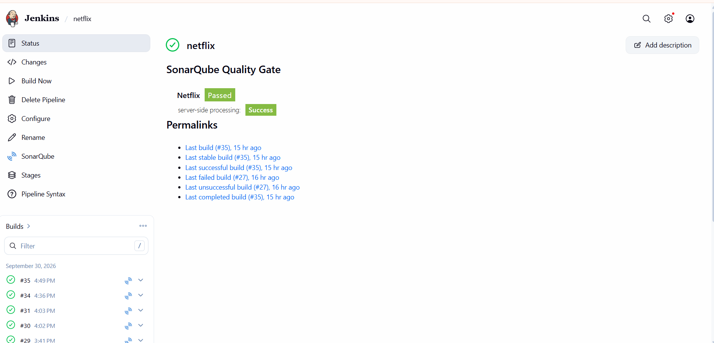 | **Jenkins: all stages green**<br>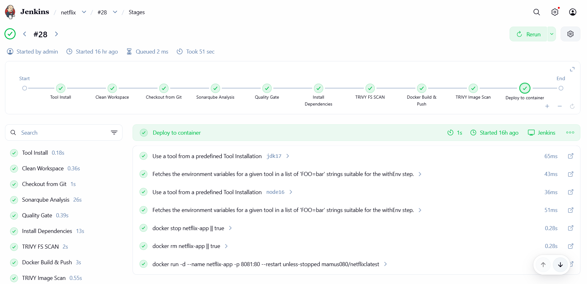 |
| **Jenkins: build history**<br>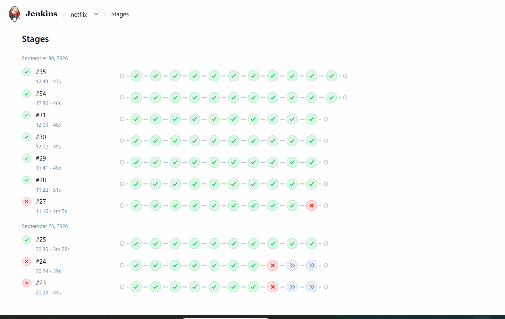 | **SonarQube: Netflix project**<br>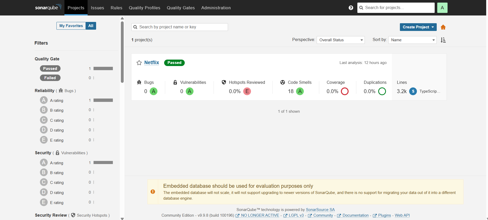 |
| **Email with Trivy reports attached**<br>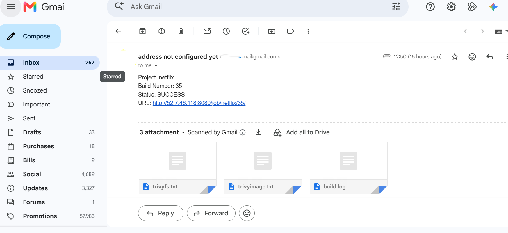 | **Prometheus: all targets UP**<br>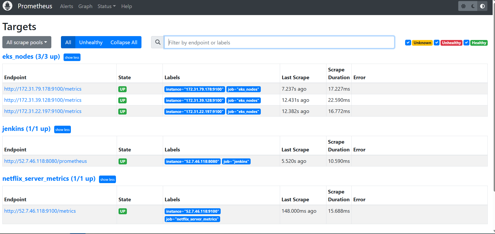 |
| **Grafana: Jenkins dashboard**<br>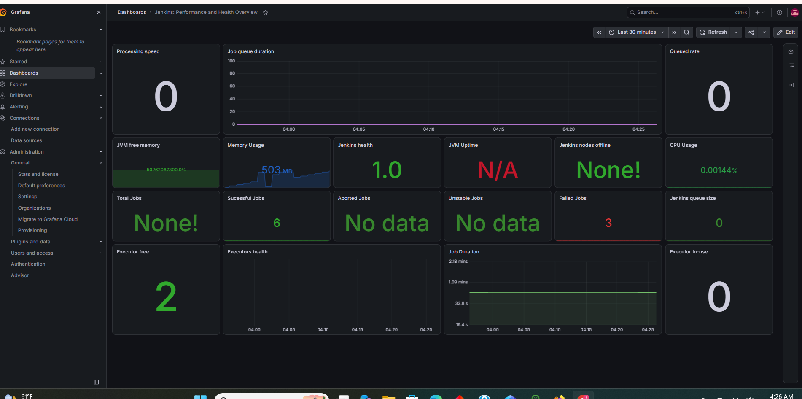 | **Argo CD: Healthy and Synced**<br>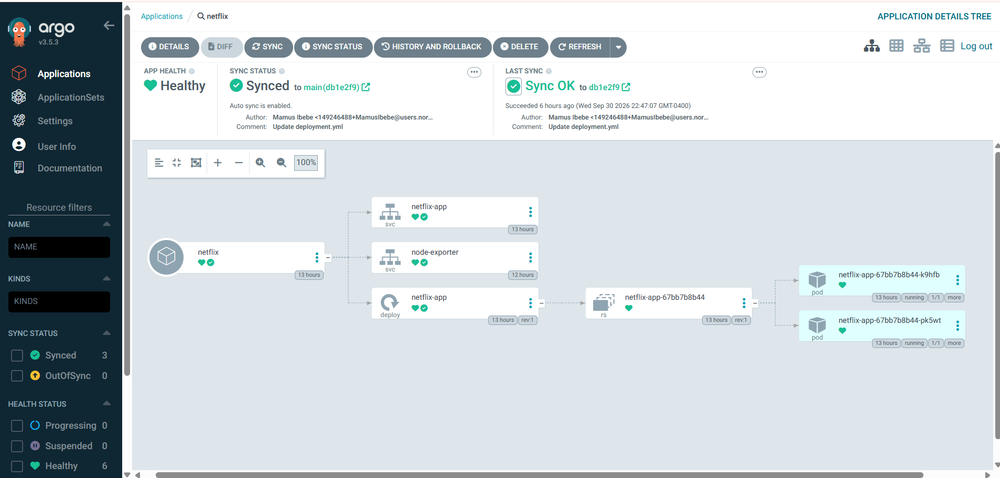 |
| **Netflix app running on EKS**<br>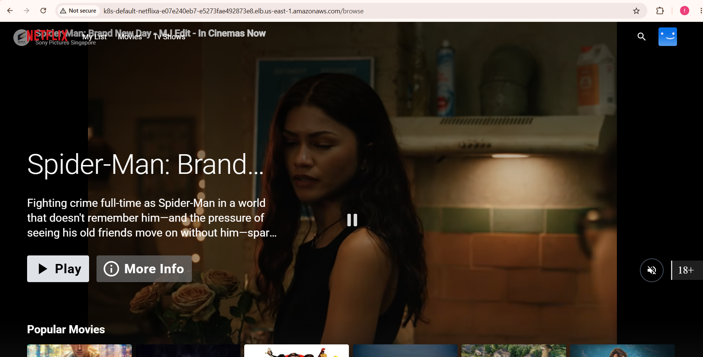 | **Debugging a failed deploy (port conflict)**<br>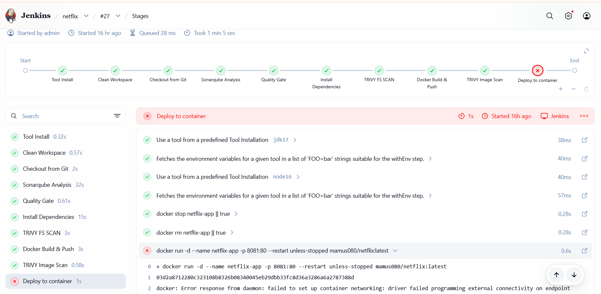 |

<!-- Add your EC2 terminal screenshots (Jenkins install, SonarQube, Trivy output, kubectl, etc.)
     to the screenshots/ folder and list them here, for example:
      -->

---

## Credits

- Application code: [N4si/DevSecOps-Project](https://github.com/N4si/DevSecOps-Project)
- Movie data: [The Movie Database (TMDB)](https://www.themoviedb.org). This product uses the TMDB API but is not endorsed or certified by TMDB.
- This is a learning project. Netflix is a trademark of Netflix, Inc., and this project is not affiliated with Netflix.
